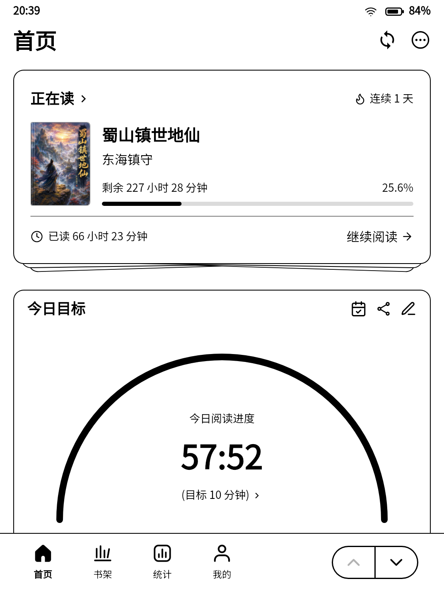

# 兼容性与真实设备截图

本项目是社区维护的非官方 Reeden→Kobo 兼容层，不是 Reeden 或 Kobo 官方产品，也不代表官方支持或背书。请先备份；Experimental 状态及已知限制仍适用。

## 设备和官方版本

| 组合 | 结果 | 证据/限制 |
|---|---|---|
| Clara Colour（393），固件 4.46.23836，官方 Kindle 1.43.2+791，适配层 0.7.2 | 已完成本轮实体基本验收 | USB 保留数据升级、阅读/灯光、充电锁屏 CPU、短时深睡唤醒和退出，见 [记录](真机验收-0.7.2.md) |
| 同设备，官方 Kindle 1.43.1+780 | 历史实体测试通过 | 非本轮最新版全面复测，见 [历史记录](测试说明.md) |
| 0.7.3 电脑安装/卸载工具 | 三平台模拟 USB 盘和启动脚本 CI 通过 | 未在个人设备上执行彻底删除 |
| 0.7.4 安装器解包加固 | 自动化回归及真实包组装检查；见当前 Actions | 不等于新的实体硬件全量验收；阅读/电源路径延续 0.7.2 |
| 其他 Kobo 型号或产品代码 | 不支持，安装和启动拒绝 | 不能用同分辨率推断兼容 |
| 其他固件 | 未验证 | 不承诺可运行 |
| 未列入白名单的官方 Kindle 包 | 拒绝组包 | 不能直接覆盖核心自行升级 |

## 功能范围

| 功能 | 当前证据 |
|---|---|
| 阅读、进度、前光与暖光、返回原生系统 | 本轮实体用户确认正常 |
| 白底/黑底/彩色刷新路径 | 算法及隔离显示测试，历史实体体验改善；不保证所有内容无残影或无闪烁 |
| 充电锁屏 / 拔线电源键唤醒 | 本轮短时实体通过，同一进程恢复 |
| 隔夜休眠、真实电池续航、完整长时掉电对照 | 尚未验收 |
| 保护盖休眠 | community.4 新增内部 SW_LID / 已知 Kobo KEY_F1 监听，识别成功后默认启用；不退出 Reeden 即可合盖锁屏。未知传感器明确不支持，开盖唤醒与隔夜耗电待实机验收 |
| 设备控制面板 | 顶部中间下拉；真实 Wi-Fi 开关、状态刷新、立即锁屏。首次配网仍用原生系统；返回原生后沿用开关选择需要已有 NickelDBus，否则不能保证同步 |
| 自动空闲休眠 | 尚未实现 |
| Windows/macOS/Linux USB 工具 | Python 3.10/3.12 CI 模拟盘和脚本检查；仅 macOS USB 升级有本轮实体证据 |
| 无线一键安装 | 本轮因连接不稳定改用 USB，不能列为通过 |
| 诊断密钥 SSH | 本轮重启后登录成功，密码方式被拒绝；默认不开启 |

## 真实设备截图

采集于 2026-11-01，Clara Colour（393）/ 固件 4.46.23836 / 适配层 0.7.2 / 官方 Kindle 1.43.2+791。用户准备可公开页面后，经 SSH 只读采集设备 `/dev/fb0` 帧缓冲，以 RGB 像素无内容改绘地编码为 PNG；不是概念图或模拟器。画面中的阅读统计是应用 UI 数据，不是功耗或续航测量。截图不反映实体 E Ink 面板的残影、色彩观感、白闪、前光或触感。
